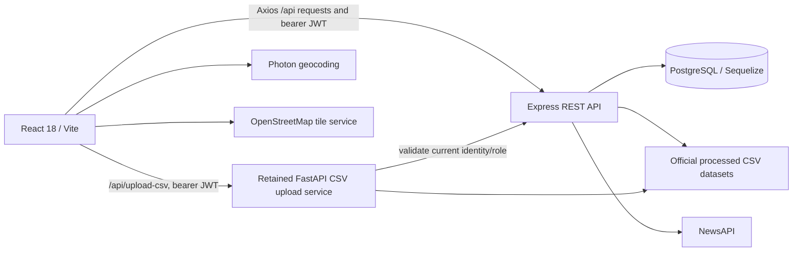
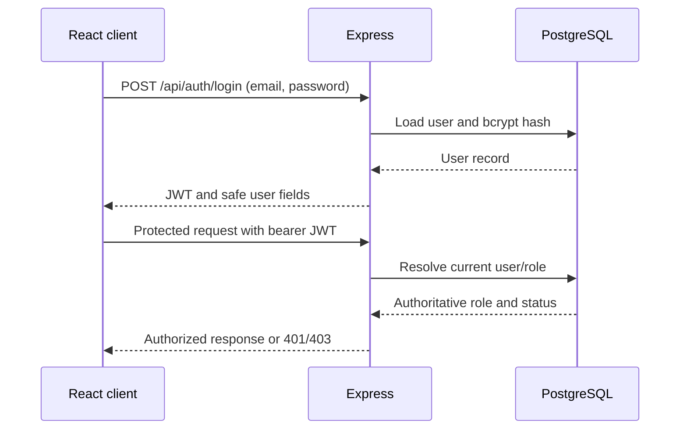

# CrimeMap Architecture

## System overview

The browser application is a React 18 single-page application built with Vite. It uses React Router for page navigation, an authentication context for session state, a shared Axios service for API calls, and lazy route-level page loading with a visible suspense fallback. Maps use Leaflet/React Leaflet with OpenStreetMap tiles; Photon supplies location search and reverse geocoding.

## Frontend architecture

- `frontend/src/pages` contains route-level screens and dashboards.
- `frontend/src/components` contains shared report, analytics, navigation, and map components.
- `frontend/src/context` owns authentication state and token restoration.
- `frontend/src/services` contains Axios/API and location/analytics adapters.
- Protected route components gate authenticated and administrator views in the UI. The backend independently enforces authorization.

The frontend sends migrated API traffic to Express under `/api`. The Vite development proxy sends the remaining `/api/upload-csv` endpoint to FastAPI. Evidence images are retrieved through an authenticated Express request, not a public static URL.

## Backend architecture

Express is the primary API in `server/`: routes dispatch to controllers, services hold application logic, Sequelize models map users and citizen crime reports, middleware handles authentication/authorization and errors, and explicit migrations define schema changes. It serves auth, citizen report and evidence, official CSV analytics, and news endpoints.

FastAPI under `backend/app` remains only where legacy CSV upload/data processing has not been migrated. For secured legacy administrative operations, FastAPI delegates identity and current role checks to Express. It does not serve the upload directory statically. Local verification binds FastAPI to `127.0.0.1`.

## Database architecture

PostgreSQL stores `users` and `crime_reports`, linked by report ownership (`reportedBy` to user ID). The report model includes location, category, incident and review state, privacy, and evidence metadata. Passwords are bcrypt hashes. Official aggregated crime statistics remain files under `backend/data`; they are not inserted into the citizen report table.

Migrations are explicit. The project does not use destructive Sequelize synchronization. The development test/seed safety guard permits writes only to the isolated local `127.0.0.1/crimemap_admin_dev` database.

## Authentication and authorization flow

The frontend stores the session token according to the existing auth context implementation and asks `/api/auth/me` to restore the user. A role displayed in the client is for UI decisions only; Express checks the authenticated database user for API authorization. FastAPI validates legacy authorization through Express.

## API communication and data flow

- Authentication and report workflows use JSON, except report creation with image evidence, which uses multipart form data.
- Evidence is stored in the existing backend upload area with metadata in PostgreSQL and is served by an authenticated Express evidence route.
- Analytics services read processed state CSVs and district coordinate data; filter and aggregation response contracts are documented in `ANALYTICS_AND_NEWS.md`.
- News searches are handled server-side using `NEWS_API_KEY`; the key is not exposed to Vite.
- CSV upload remains a separate FastAPI operation. It validates the canonical state, headers, row shapes, supported count columns, numeric counts, and a 10 MB maximum before processing; both upload input and processed output are configurable in tests, while production processing merges the processed CSV by district/year.

## Configuration and deployment boundary

Secrets belong in ignored backend environment files or deployment secrets. Browser variables must use `VITE_` and contain only public settings such as the API URL or map display configuration. Local Express defaults to `127.0.0.1:5000`; production host binding, HTTPS, origins, and service networking require deployment-specific configuration and have not been validated by this audit.
