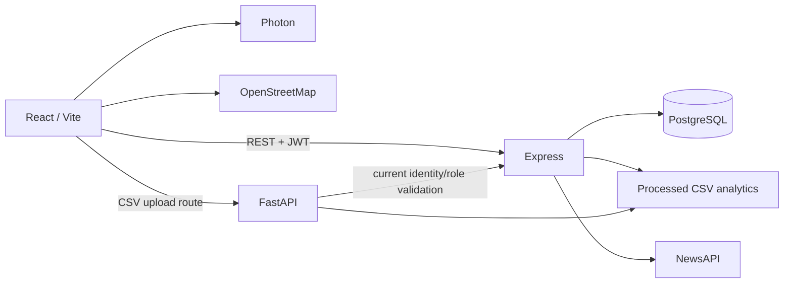

# CrimeMap: Full-Stack Crime Analytics and Geospatial Visualization

## 1. Abstract

CrimeMap is a web application that presents official district-level crime statistics alongside a separate citizen-submitted report workflow. It combines interactive maps, charts, authenticated reporting, administrator review, and crime-news search. The application uses React and Leaflet in the browser, Express for its primary REST API, PostgreSQL through Sequelize for user and report persistence, and a retained FastAPI service for CSV upload.

## 2. Introduction

Crime information is useful when users can explore it by place, category, and time. CrimeMap provides a map-centered interface for exploring the datasets included with the project and a controlled workflow for submitting and reviewing reports. Official statistics and user reports are kept separate because they have different sources and meanings.

## 3. Problem statement

Aggregated crime statistics, geographic context, news, and community-submitted reports are often separated across interfaces. Users need a way to inspect the available data geographically, while administrators need a controlled process to review citizen reports without treating them as official statistics.

## 4. Objectives

- Display the provided official crime statistics by state, district, category, and year.
- Present trends, hotspots, summaries, and map views.
- Allow authenticated users to submit reports and track their own reports.
- Allow authorized administrators to review, verify, or reject reports.
- Protect account credentials, report ownership, and evidence access.
- Demonstrate a React, Express, and PostgreSQL application with a retained legacy CSV workflow.

## 5. Existing system and limitations

The repository originated as a React/FastAPI application with JSON-backed authentication/report data and Google mapping. The current primary application has migrated authentication and citizen reporting to Express/PostgreSQL and mapping to Leaflet/OpenStreetMap with Photon geocoding. The original service remains for CSV upload and selected historical code. The included datasets and external NewsAPI/Photon services constrain available data and availability.

## 6. Proposed system

The browser communicates with Express for authentication, reports, analytics, and news. Sequelize persists users and citizen reports in PostgreSQL. Analytics calculations read the existing processed CSV data without importing it into the reports table. FastAPI remains an isolated legacy service for administrator CSV uploads and delegates authorization to Express.

## 7. Scope

In scope are local account registration/login, protected report workflows, evidence metadata and authenticated retrieval, CSV-backed analytics, map visualization, Photon location search, NewsAPI integration, and legacy CSV upload. Cloud deployment, operational monitoring, and a production security certification are outside the verified scope.

## 8. Functional requirements

- Register and authenticate users; retrieve the authenticated profile.
- Create, list, view, edit, and delete reports subject to ownership and workflow rules.
- Review, verify, and reject reports with administrator authorization.
- Upload and retrieve supported evidence through protected paths.
- Filter and view official analytics, maps, hotspots, benchmarks, and trends.
- Search for locations and show news results when the provider is configured.
- Upload analytics CSV files through the retained FastAPI endpoint.

## 9. Non-functional requirements

The system separates frontend, API, and persistence concerns; validates request inputs; hashes passwords; enforces server-side authorization; avoids destructive synchronization; keeps secrets outside browser bundles; supports responsive map layouts; and returns loading/error/empty states where implemented. External services and local development availability are not guaranteed.

## 10. Technology stack

| Layer | Technologies |
|---|---|
| Frontend | React 18, Vite, JavaScript, React Router, Axios, Tailwind CSS, Recharts |
| Maps | Leaflet, React Leaflet, OpenStreetMap, Photon |
| Main backend | Node.js, Express, JavaScript ES modules |
| Persistence | PostgreSQL, Sequelize, explicit migrations |
| Authentication | bcrypt, JWT |
| Retained legacy endpoint | Python, FastAPI, CSV processing |

## 11. System architecture

See `ARCHITECTURE.md` for component and data-flow details.

## 12. Module descriptions

- **Authentication:** registration, login, JWT issuance, profile lookup, and role-based server authorization.
- **Citizen reporting:** report creation and ownership-scoped retrieval/update/deletion, workflow states, optional evidence, and description privacy.
- **Administration:** report queue and review/verification/rejection endpoints guarded by administrator role.
- **Analytics:** CSV-backed summaries, category/trend/hotspot/safety/benchmark insights, with district coordinates.
- **Geospatial UI:** Leaflet maps, OSM tiles, marker clusters, Photon search/reverse geocoding, and report location picker.
- **News:** backend NewsAPI integration with query validation and response shaping.
- **CSV upload:** retained FastAPI endpoint with delegated administrator authorization, strict CSV validation, a 10 MB cap, safe generated input filenames, and processed CSV output. It writes analytics files, not PostgreSQL rows.

No general user-management console or actual heatmap raster layer is claimed; current map density uses marker clustering and weighted markers.

## 13. Database design

The Sequelize `User` model stores account identity, email, bcrypt password hash, role, administrative role/organization fields, and active state. `CrimeReport` stores report ownership, description/category, location coordinates, incident time, status/review metadata, privacy preference, and evidence metadata. The user-to-report relation is one-to-many, with report ownership enforced by a foreign key. Exact columns and migration history are maintained in `server/models` and `server/migrations`.

## 14. API architecture

Express mounts REST endpoints under `/api`: authentication under `/auth`, reports and evidence under `/reports`, analytics at `/crimes`, `/summary`, `/by-type`, `/trend`, `/hotspots`, `/safety-score`, `/admin/insights`, `/analytics/insights`, `/analytics/benchmarks`, `/states`, and news under `/news`. The CSV upload endpoint remains `POST /api/upload-csv` on FastAPI. Detailed contracts are in `ANALYTICS_AND_NEWS.md` and `FRONTEND_EXPRESS_INTEGRATION.md`.

## 15. Implementation details

The API uses middleware for CORS, request logging, validation, authentication, authorization, not-found handling, and centralized errors. Sequelize queries parameterize data access. Passwords are never returned by serializers. Official statistics are loaded from processed CSVs and cached against file metadata. Report evidence uses generated safe filenames and authenticated retrieval. CSV ingest validates canonical state, required header/row shapes, numeric crime counts, filename containment, and a 10 MB maximum, then cleans up its temporary input. The UI uses a shared Axios layer and auth context; route-level pages are lazy-loaded with a loading fallback.

## 16. Testing methodology

Verification combined native Node test suites, Python security tests, a Vite production build, dependency-tree checks, a local API smoke test against the explicitly isolated development database, schema/model inspection, and HTTP checks against a running Vite server. Browser-driven interaction was unavailable; no browser behavior is represented as tested. See `TESTING_REPORT.md` for exact results and commands.

## 17. Test results

The final run passed 21 frontend tests, 18 Express tests, and 34 FastAPI security/CSV tests. The production frontend build succeeded without the prior large-chunk warning; lazy route splitting reduced the initial JS chunk from about 1.38 MB to about 455 kB. Live local checks confirmed admin/citizen authentication and authorization, report lifecycle cleanup, analytics endpoints, and synthetic CSV upload through a temporary Vite proxy to FastAPI. The CSV processor wrote only to temporary input/output directories. Express tests used `127.0.0.1/crimemap_admin_dev`; demo rows were preserved. Browser-side visual and interaction checks remain pending because browser automation was unavailable.

## 18. Limitations

- The app has not been browser-automated during this audit.
- Synthetic authenticated CSV processing was verified; FastAPI review/verify/reject operations were not live-tested.
- Cross-user evidence denial was covered by backend tests, but an actual browser evidence flow was not exercised.
- Public deployment, TLS termination, production CORS, NewsAPI credentials/quotas, and production database behavior were not verified.
- The dataset scope is limited to the repository CSVs; Photon and NewsAPI are external dependencies.
- The scoped Sequelize UUID override resolves its advisory. The nodemon/minimatch moderate advisory remains because the patched minimatch major requires Node 20+, while the project documents Node 18 support.

## 19. Future enhancements

Complete browser-based end-to-end testing, establish a verified deployment with TLS and monitoring, improve dataset provenance and refresh workflows, and resolve nodemon’s minimatch advisory when a patched release compatible with documented Node support is available or after explicitly raising the minimum Node version.

## 20. Conclusion

CrimeMap now combines official CSV analytics, a database-backed citizen report workflow, role-protected review, open-source map rendering, and backend news integration while keeping the legacy CSV upload function separate. Automated tests and local API checks provide evidence for core backend workflows. Browser QA and deployment verification remain necessary before presenting it as a publicly deployed service.

## 21. References

- React documentation: https://react.dev/
- Express documentation: https://expressjs.com/
- Sequelize documentation: https://sequelize.org/
- PostgreSQL documentation: https://www.postgresql.org/docs/
- Leaflet documentation: https://leafletjs.com/
- OpenStreetMap tile usage policy: https://operations.osmfoundation.org/policies/tiles/
- Photon API: https://photon.komoot.io/
- NewsAPI documentation: https://newsapi.org/docs
